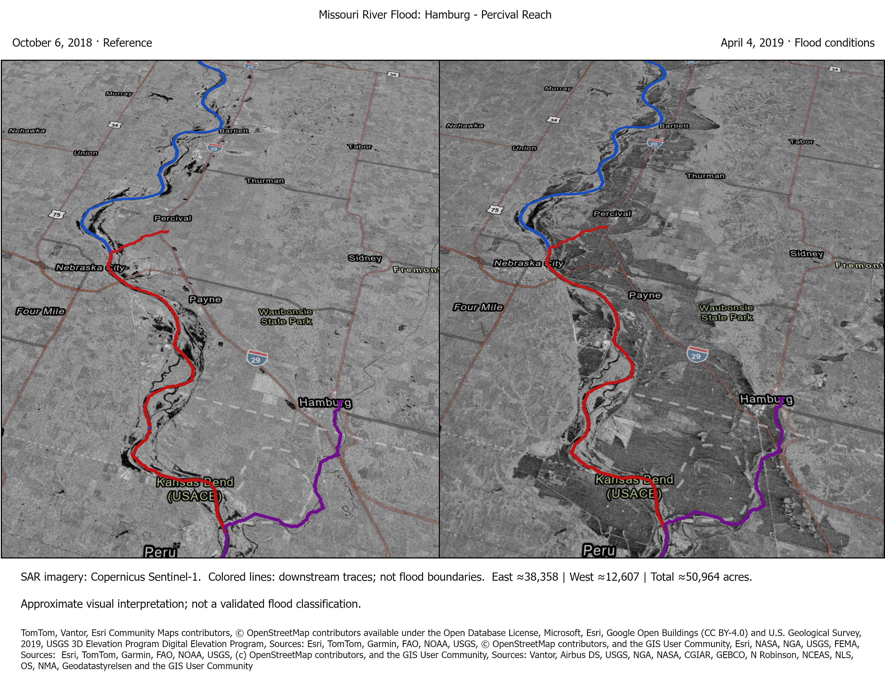

# ArcGIS Pro Sentinel-1 SAR - Missouri River Flood 2019

A Sentinel-1 radar imagery comparison of the Missouri River floodplain near Hamburg and Percival, Iowa. This project demonstrates SAR preprocessing, raster alignment validation with Python, visual interpretation, polygon editing, and geodesic area calculation in ArcGIS Pro.

## Objective

Compare reference conditions from October 6, 2018, with flood conditions on April 4, 2019, and estimate the area within manually interpreted inundation boundaries on the east and west sides of the river.

## Data and tools

| Component | Source or tool |
|---|---|
| Radar imagery | Copernicus Sentinel-1 IW GRD, VV/VH polarization |
| Reference acquisition | October 6, 2018 |
| Flood acquisition | April 4, 2019 |
| Terrain correction DEM | SRTM, 30 m |
| Processing and mapping | ArcGIS Pro with Image Analyst |
| Raster validation | Python notebook in ArcGIS Pro |
| Spatial reference | WGS 84 — EPSG:4326 |
| Context layers | Esri reference mapping, Iowa DOT roads, and Esri 3D Buildings |

Context layers support orientation and visualization. They were not used to calculate building damage, road closures, or asset exposure.

## Workflow

1. Preprocessed the Sentinel-1 imagery using orbit correction, thermal noise removal, radiometric calibration, terrain flattening, speckle filtering, and geometric terrain correction.
2. Resampled the April raster to the October reference grid using bilinear interpolation and the reference raster's cell size and snap settings.
3. Validated the coordinate systems, cell sizes, grid origins, and pixel offsets in Python.
4. Compared the processed imagery in linked views, using reference layers to locate communities, roads, and drainage features.
5. Manually digitized approximate inundation polygons east and west of the Missouri River, using the reference image to distinguish existing river water.
6. Calculated geodesic polygon areas in US survey acres.
7. Exported a comparison layout as a PNG for this repository.

## Raster alignment validation

The [validation notebook](notebooks/raster_alignment_validation.ipynb) retains the checks and their outputs.

| Check | Result |
|---|---|
| Both rasters use EPSG:4326 | Pass |
| Matching X/Y cell sizes | Pass |
| April offset relative to reference grid | 0 pixels in X and Y |
| Whole-cell grid offsets | Pass |

The rasters have slightly different row and column counts. Their pixel grids align, but their coverage is not identical. These checks verify grid compatibility; they do not independently establish positional accuracy.

## Interpretation and area estimates

Visual comparison shows a broader area of apparent inundation across the floodplain in the April 2019 image.

| Manually delineated area | Approximate acres |
|---|---:|
| East of the river | 38,358 |
| West of the river | 12,607 |
| Combined | 50,964 |

The combined value was rounded after summing the underlying calculated values, so it differs slightly from the sum of the rounded entries.

These figures describe the area enclosed by the manually interpreted polygons. They are approximate estimates, not a validated pixel-level flood classification.

The colored lines on the comparison map are downstream traces used for geographic context - not flood boundaries.

## Limitations

- Boundaries were interpreted manually from processed SAR imagery and generalized during digitization.
- The two acquisitions represent different seasons; backscatter differences cannot all be attributed to flooding.
- Building and road layers provide context and may not represent conditions at the acquisition dates.
- This project does not model flood depth, flow velocity, levee performance, or infrastructure damage.

## Repository contents

- `images/missouri_flood_comparison.png` - exported comparison map
- `notebooks/raster_alignment_validation.ipynb` - raster alignment checks with saved outputs
- `README.md` - methods, results, and limitations

## Reproducing the validation

The notebook uses ArcPy and requires an ArcGIS Pro Python environment.

Large source imagery, processed rasters, the local geodatabase, and the ArcGIS Pro project are excluded from this repository. To rerun the checks, supply the corresponding processed raster inputs and update the notebook's file paths.

## Credits

SAR imagery: Copernicus Sentinel-1.

Context mapping and service-layer attribution are included in the exported map. Context layers include Esri mapping services and Iowa DOT road data.